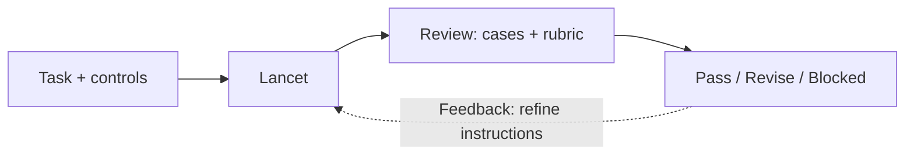

# Lancet

**Precision over complexity.**

A focused coding agent with two MVP requirements: surgical code changes and
plain-English replies that are short and complete each round.

Version **0.1.0** packages one portable skill for GitHub Copilot, OpenAI
Codex/ChatGPT, and Claude Code. The workflow and evaluation cases are Markdown;
only plugin and marketplace metadata use JSON. There is no runtime code, hook,
MCP server, or model-training setup. The host provides tools and permissions.

## Structure

```text
lancet/
  .agents/plugins/marketplace.json       # Local OpenAI plugin catalog
  plugins/lancet/
    plugin.json                         # Portable Copilot/OpenAI manifest
    .claude-plugin/plugin.json           # Claude Code compatibility manifest
    .codex-plugin/plugin.json            # OpenAI compatibility manifest
    skills/surgical-coding/
      SKILL.md                          # Canonical agent instructions
      references/
        rubric.md                       # Two acceptance criteria
        test-cases.md                   # JSON-formatted manual cases
  program.md                            # Manual entry point; no duplicated rules
  INSTALL.md
  README.md
```

The skill is self-contained. Install the plugin, or copy the complete
[surgical-coding/](./plugins/lancet/skills/surgical-coding/) folder as a standalone skill.
Do not install both forms in the same host scope.

## Use

See [INSTALL.md](./INSTALL.md) for plugin installation, standalone skill
locations, and host-specific invocation. A skill is loaded on demand, not an
always-on rule. Select it explicitly when you need this behavior.

Without installing, give your coding tool access to the target repository:

```text
Read /path/to/lancet/program.md and follow it for this task.
Work in /path/to/target-repository.
Task: <describe the desired behavior and any constraints>
```

These instructions guide an existing agent; they do not grant tools, permissions,
or guarantee behavior. Keep the tool's approval controls enabled.

## MVP acceptance

Both criteria must pass. Good replies cannot compensate for broken or unrelated
code, and good code cannot compensate for unclear or incomplete replies.

| Criterion | Pass when |
| --- | --- |
| **Surgical coding** | The requested behavior works, relevant existing behavior is preserved, and every changed hunk serves the task or a direct consequence. Use readable local patterns without speculative abstractions. Verify with focused checks. |
| **Plain, short, complete replies each round** | Every user-visible response leads with the answer, outcome, blocker, or necessary question in plain English. Keep only information needed for that round. A delivery reply states what changed and the verification status, plus material caveats or next steps. |

Default to one short paragraph or a short list. Use more detail only when needed
for completeness or explicitly requested. Review clarifications and progress
updates too, not just the final reply.

Start with the bug-fix case in
[test-cases.md](./plugins/lancet/skills/surgical-coding/references/test-cases.md) and review its
diff, check results, and replies against the
[MVP checklist](./plugins/lancet/skills/surgical-coding/references/rubric.md#mvp-checklist).
No numeric score, runtime, or benchmark suite is required.

### Current design



Use evaluation feedback to refine the agent's instructions, then rerun the same
tasks. This is a human-directed loop, not automatic self-modification.

Like autoresearch, separate what changes from how it is evaluated. Autoresearch
changes training code against a fixed `val_bpb` evaluator and training budget.
Here, the coding tool changes a target repository; a reviewer checks the diff,
repository test results, and replies against the cases and rubric. Readability
and reply quality remain explicit human judgments.
Do not copy autoresearch's infinite loop, automatic resets, or disabled approvals.

## Evaluate

Use [rubric.md](./plugins/lancet/skills/surgical-coding/references/rubric.md#mvp-checklist) to
record **pass**, **revise**, or **blocked** for the two MVP criteria, with
evidence. A known failure means revise; missing evidence means blocked, not pass.
Safety, preservation of user work, and truthful reporting remain mandatory.

Before each run, choose a case, record the starting state, and map its allowed
scope and behavior checks to actual files and existing repository commands.
These cases describe expectations; they do not execute tests or enforce scope.

Keep controls simple: allowed changes, required verification, and reply detail
(brief by default). Keep the diff, check output, and every reply as evidence.
An independent reviewer records the outcome using the JSON template in
[rubric.md](./plugins/lancet/skills/surgical-coding/references/rubric.md#review-record), stored
inside a Markdown evaluation record.

Compare instruction revisions using the same case, starting state, controls,
and model/tool configuration. Record failed and blocked attempts too. Improve
[SKILL.md](./plugins/lancet/skills/surgical-coding/SKILL.md) from observed failures, not smaller
diffs or shorter replies alone. Keep all plugin manifests' names, versions,
and descriptions in sync when releasing an update.
